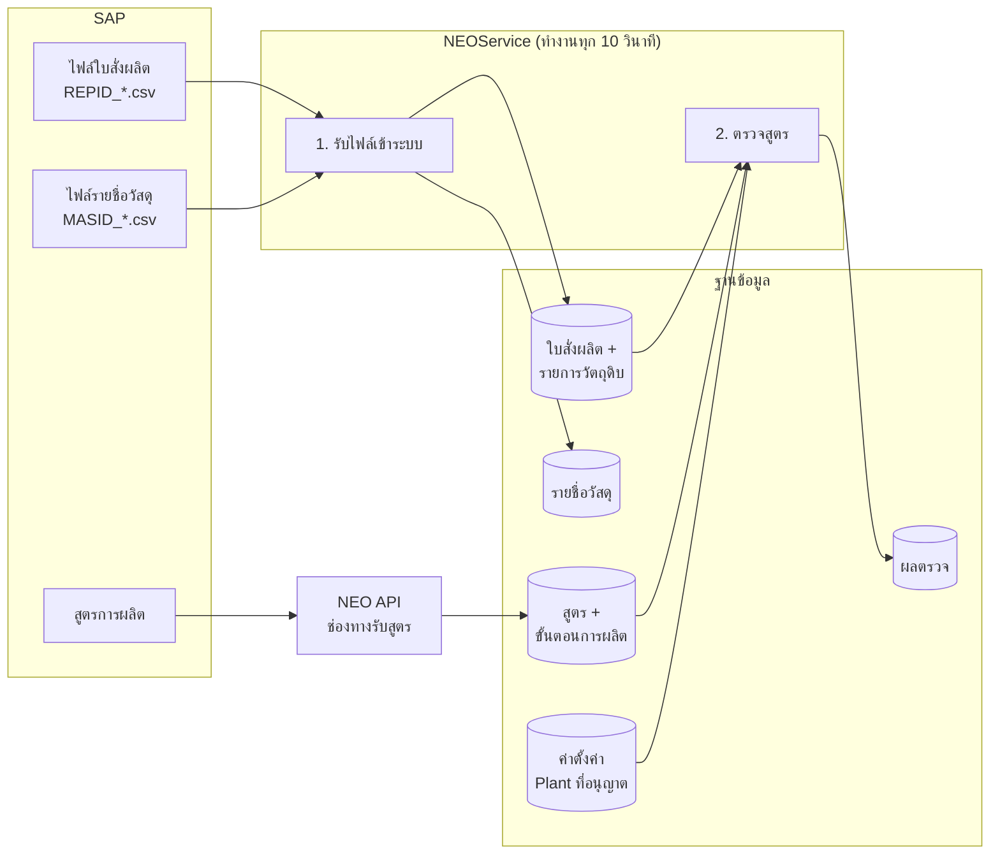
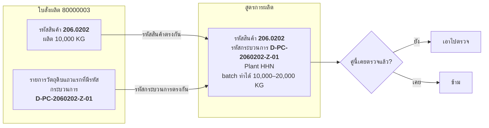
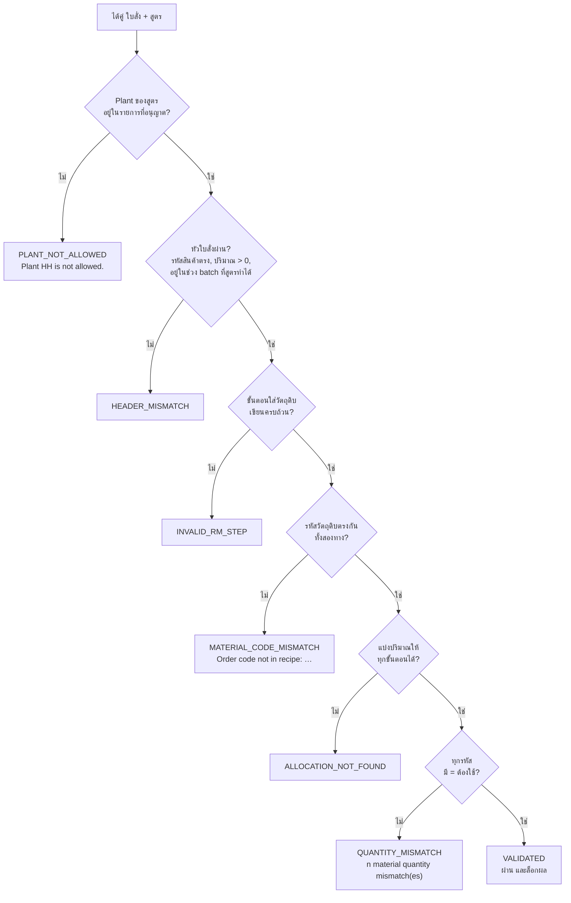
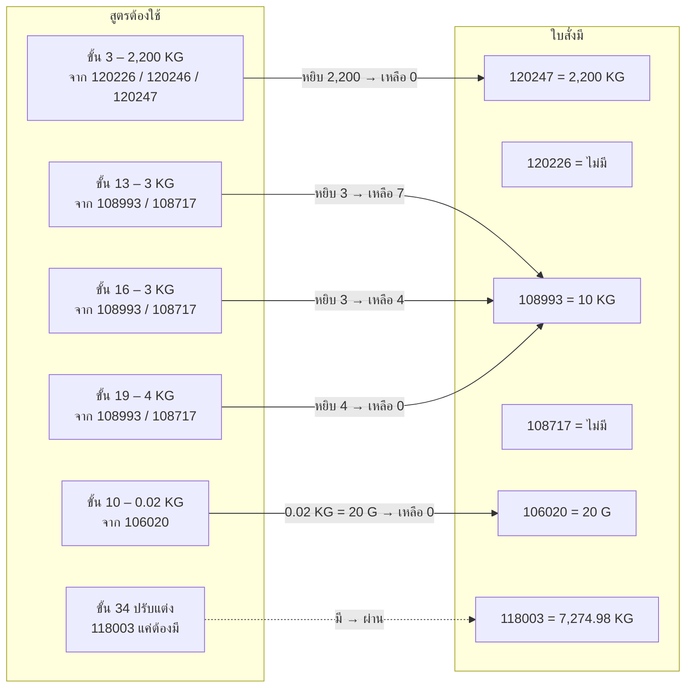
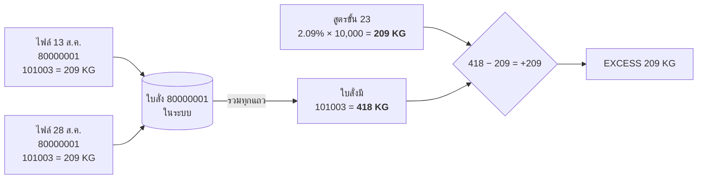

# การตรวจสูตรของ NEOService ทำงานอย่างไร

เอกสารนี้อธิบายแบบไม่ต้องรู้โปรแกรม ว่าข้อมูลมาจากไหน ระบบเอาอะไรไปเทียบกับอะไร ตัดสินด้วยกฎอะไร และทำไมผลตรวจแต่ละใบจึงออกมาแบบนั้น ตัวอย่างทั้งหมดเป็นข้อมูลจริงในระบบทดสอบ ณ วันที่ 12 ต.ค. 2026

---

## 1. ของสองอย่างที่ต้องมาเจอกัน

การตรวจสูตรคือการเอา **ใบสั่งผลิต** มาเทียบกับ **สูตรการผลิต** ของสินค้าตัวเดียวกัน ของสองอย่างนี้มาคนละทาง

| | ใบสั่งผลิต | สูตรการผลิต |
|---|---|---|
| มาจาก | SAP ส่งเป็นไฟล์ชื่อขึ้นต้น `REPID_` วางไว้ในโฟลเดอร์รับไฟล์ | SAP ส่งตรงเข้าระบบผ่านช่องทางรับสูตร (NEO API) |
| ใครรับเข้า | NEOService อ่านไฟล์ทุก 10 วินาที | NEO API รับทันทีที่ SAP ส่ง |
| ข้างในมีอะไร | เลขใบสั่ง, รหัสสินค้าที่จะผลิต, ปริมาณที่จะผลิต (ขนาด batch), และรายการวัตถุดิบที่ต้องใช้พร้อมปริมาณ (BOM) | รหัสสินค้า, รหัสกระบวนการ, โรงงาน (Plant), ช่วงขนาด batch ที่ทำได้, และขั้นตอนการผลิตทีละขั้น ซึ่งบางขั้นระบุว่าใส่วัตถุดิบรหัสอะไร กี่เปอร์เซ็นต์ |

นอกจากนี้ยังมีไฟล์ `MASID_` ซึ่งเป็นรายชื่อวัสดุ (ชื่อ หน่วย โซนจัดเก็บ) ใช้เป็นข้อมูลอ้างอิง ไม่เกี่ยวกับการตัดสินผลตรวจ

**ประเด็นสำคัญ** การรับไฟล์เข้ากับการตรวจสูตรเป็นคนละขั้นกัน ไฟล์เข้าสำเร็จแปลว่าใบสั่งถูกเก็บแล้ว แต่จะมีผลตรวจก็ต่อเมื่อหาสูตรคู่กันเจอ

---

## 2. ขั้นที่ 1 – รับไฟล์ใบสั่งเข้าระบบ

1. ระบบมองหาไฟล์ `.csv` ในโฟลเดอร์รับไฟล์
2. ไฟล์ที่เพิ่งเห็นครั้งแรกยังไม่แตะ รอรอบถัดไป (10 วินาที) ถ้าขนาดไฟล์เท่าเดิมถึงถือว่าเขียนเสร็จแล้ว กันกรณี SAP ยังส่งไม่จบ
3. อ่านทั้งไฟล์ แยกเป็น "หัวใบสั่ง" (เลขใบสั่ง รหัสสินค้า ปริมาณ) และ "รายการวัตถุดิบ" (รหัส ปริมาณ หน่วย และรหัสกระบวนการ)
4. บันทึกทั้งไฟล์ในครั้งเดียว ถ้าแถวใดผิดพลาด ยกเลิกทั้งไฟล์ ไม่มีครึ่ง ๆ กลาง ๆ
5. สำเร็จ → ย้ายไฟล์ไปโฟลเดอร์ `Success` ผิดพลาด → ย้ายไป `Error`

**ข้อควรรู้** ระบบไม่เช็กว่าเลขใบสั่งนี้เคยเข้ามาแล้วหรือยัง ถ้าไฟล์เดิมถูกวางซ้ำ ใบสั่งจะถูกเก็บซ้ำอีกชุด และจะมีผลต่อการตรวจ (ดูตัวอย่าง C และ F)

---

## 3. ขั้นที่ 2 – หาว่าใบสั่งไหนคู่กับสูตรไหน

ทุกรอบ ระบบไล่ใบสั่งที่ยังไม่ถูกยกเลิกทีละใบ

1. ดูรายการวัตถุดิบของใบสั่งนั้น หา **แถวแรกที่มีรหัสกระบวนการ** (ช่อง ProcessNo ในไฟล์) ใช้ค่านี้เป็นรหัสกระบวนการของใบสั่ง
2. ไปหาสูตรที่ **รหัสสินค้าเท่ากับรหัสสินค้าของใบสั่ง** และ **รหัสกระบวนการเท่ากับที่ได้จากข้อ 1** และสูตรยังไม่ถูกยกเลิก
3. ถ้าเจอสูตรหลายฉบับ (SAP ส่งซ้ำ หรือมีหลายรุ่น) เลือกฉบับเดียว: วันที่มีผลใหม่สุด → เลขรุ่น (Revision) มากสุด → ที่รับเข้ามาหลังสุด
4. ดูว่าคู่ "ใบสั่งใบนี้ + สูตรฉบับนี้" เคยมีผลตรวจแล้วหรือยัง ถ้าเคยแล้ว ข้าม ถ้ายังไม่เคย เอาไปตรวจ

ผลที่ตามมาจากกฎข้อนี้

- ใบสั่งที่ **ไม่มีรหัสกระบวนการเลยสักแถว** จะไม่ถูกตรวจ เพราะไม่รู้จะไปหาสูตรไหน
- ใบสั่งที่มีรหัสกระบวนการ แต่ **ยังไม่มีสูตรของสินค้านั้นเข้ามาในระบบ** จะไม่ถูกตรวจ และไม่มีแถวผลใด ๆ ไม่ใช่ความผิดพลาด แค่ยังไม่มีคู่ พอสูตรเข้ามาภายหลัง รอบถัดไปจะตรวจให้เอง
- ผลตรวจ **ไม่ถูกตรวจซ้ำ** แม้จะเปลี่ยนค่าตั้งค่าภายหลังก็ไม่เขียนทับ ถ้าต้องการให้ตรวจใหม่ ต้องลบผลเดิมก่อน
- ไฟล์ใบสั่งเดิมที่วางซ้ำ จะกลายเป็นใบสั่ง "ชุดใหม่" ในระบบ จึงเป็นคู่ใหม่และถูกตรวจอีกครั้ง

---

## 4. ขั้นที่ 3 – เช็ก Plant ก่อนทำอย่างอื่น

ในระบบมีค่าตั้งค่าชื่อ **`BATCH_ALLOWED_PLANTS`** เป็นรายชื่อ Plant ที่อนุญาตให้ตรวจสูตร คั่นด้วยจุลภาค

| ค่าที่ตั้ง | ผล |
|---|---|
| ว่าง หรือไม่มี | ไม่กรอง ตรวจทุก Plant |
| `HHN` | ตรวจเฉพาะสูตรของ Plant HHN |
| `HH,HHN` | ตรวจทั้งสอง |

Plant ที่เอามาเทียบคือ **Plant ที่ระบุในสูตร** ไม่ใช่รหัสโรงงานในไฟล์ใบสั่ง (ไฟล์ใบสั่งจาก SAP เขียนรหัสโรงงานเป็นตัวเลข เช่น `30` ซึ่งเป็นคนละอย่างกัน)

ถ้า Plant ของสูตรไม่อยู่ในรายการ ระบบ **หยุดทันทีแต่ยังบันทึกผล** เพื่อให้รู้ว่าใบนี้ถูกกรอง

| สิ่งที่บันทึก | ค่า |
|---|---|
| สถานะ | 2 (ไม่ผ่าน) |
| ผล | `PLANT_NOT_ALLOWED` |
| รายละเอียด | `Plant HH is not allowed.` |
| จำนวนข้อผิด | 1 |
| ล็อกผล (Frozen) | ไม่ |
| รายละเอียดรายขั้นตอน / รายวัตถุดิบ | ไม่มี เพราะไม่ได้คำนวณ |

ค่าปัจจุบันในระบบทดสอบคือ `HHN`

---

## 5. ขั้นที่ 4 – เช็กหัวใบสั่งกับหัวสูตร

ก่อนลงรายละเอียดวัตถุดิบ ระบบเช็กเรื่องใหญ่ ๆ ก่อน ถ้าข้อใดไม่ผ่าน ผลคือ `HEADER_MISMATCH` และไม่คำนวณต่อ

| เช็กอะไร | ไม่ผ่านเมื่อ | ข้อความที่บันทึก |
|---|---|---|
| รหัสสินค้า | ใบสั่งกับสูตรคนละรหัส | `BulkCode mismatch: Order=… Recipe=…` |
| ปริมาณที่จะผลิต | เป็น 0 หรือติดลบ | `TargetQty / BatchQty must be greater than 0` |
| สูตรมีขั้นตอน | สูตรว่างเปล่า | `Process step not found` |
| ขนาด batch ขั้นต่ำ | ผลิตน้อยกว่าที่สูตรทำได้ | `BatchQty 100 is below BatchSizeMin 3500` |
| ขนาด batch สูงสุด | ผลิตมากกว่าที่สูตรทำได้ | `BatchQty … exceeds BatchSizeMax …` |

หน่วยที่ใช้คำนวณทั้งใบ = หน่วยของปริมาณที่จะผลิตในใบสั่ง (ปกติ KG)

---

## 6. ขั้นที่ 5 – ดูว่าขั้นตอนไหนของสูตรเป็นขั้นตอน "ใส่วัตถุดิบ"

สูตรหนึ่งฉบับมีขั้นตอนหลายสิบขั้น (ผสม ให้ความร้อน ตรวจค่า ฯลฯ) ระบบสนใจเฉพาะขั้นที่ **ใส่วัตถุดิบ** ซึ่งดูจากช่องข้อมูลในขั้นตอนนั้น

- ช่องแรกเขียนว่า `RM Code` และช่องที่สามเขียนว่า `%RM` → เป็นขั้นตอนใส่วัตถุดิบ
- ช่องที่สอง = **รหัสวัตถุดิบที่ใช้ได้** ถ้ามีหลายรหัสคั่นด้วย `|` แปลว่า "ใช้ตัวใดตัวหนึ่งก็ได้" เช่น `120226|120246|120247`
- ช่องที่สี่ = **เปอร์เซ็นต์ของ batch** เช่น `22` หมายถึง 22% ของปริมาณที่ผลิต

ขั้นตอนใส่วัตถุดิบมี 2 แบบ

| แบบ | ดูจาก | ระบบตรวจอะไร |
|---|---|---|
| **กำหนดเปอร์เซ็นต์** (`FIXED_PERCENT`) | มีตัวเลขเปอร์เซ็นต์ | ตรวจทั้งรหัสและปริมาณ: ต้องใช้ = ปริมาณผลิต × % ÷ 100 |
| **ปรับแต่ง** (`ADJUST`) | ไม่มีตัวเลขเปอร์เซ็นต์ และชื่อขั้นตอนมีคำว่า ADJUST | ตรวจแค่ว่ารหัสนี้มีในใบสั่ง ไม่ล็อกปริมาณ เพราะเป็นของที่เติมปรับหน้างาน |

ถ้าเป็นขั้นตอนใส่วัตถุดิบแต่ไม่มีรหัส หรือเปอร์เซ็นต์ไม่ใช่ตัวเลข → ผล `INVALID_RM_STEP` (สูตรเขียนมาไม่สมบูรณ์)

---

## 7. ขั้นที่ 6 – เทียบรหัสวัตถุดิบ

เอารหัสจากทุกขั้นตอนใส่วัตถุดิบมารวมเป็น "รายชื่อรหัสที่สูตรรู้จัก" แล้วเทียบสองทาง

1. **ใบสั่งมีของที่สูตรไม่รู้จักไหม** – รหัสในใบสั่งที่มีปริมาณ แต่ไม่อยู่ในรายชื่อเลย → `Order code not in recipe: 118003`
2. **สูตรต้องการของที่ใบสั่งไม่มีไหม** – ขั้นตอนที่รหัสที่ใช้ได้ทุกตัวไม่มีในใบสั่ง → `Recipe step has no BOM candidate: …`

พบอย่างใดอย่างหนึ่ง → ผล `MATERIAL_CODE_MISMATCH` และไม่คำนวณปริมาณต่อ (เพราะรหัสยังไม่ตรง คำนวณไปก็ไม่มีความหมาย)

---

## 8. ขั้นที่ 7 – เทียบปริมาณ

ทำเฉพาะเมื่อหัวใบสั่งและรหัสผ่านหมดแล้ว

1. แปลงปริมาณวัตถุดิบในใบสั่งทุกรหัสให้เป็นหน่วยเดียวกับปริมาณผลิต (กรัม ÷ 1,000 เป็น KG, มิลลิกรัม ÷ 1,000,000)
2. ขั้นตอนแบบกำหนดเปอร์เซ็นต์แต่ละขั้น คำนวณ "ต้องใช้เท่าไร" แล้ว **หยิบ** จากรหัสใดรหัสหนึ่งที่ขั้นตอนนั้นอนุญาต
3. ระบบลองจัดว่าขั้นตอนไหนหยิบรหัสไหน โดยเริ่มจากขั้นตอนที่มีตัวเลือกน้อยก่อน และห้ามหยิบเกินที่ใบสั่งมี (ยอมคลาดเคลื่อน 0.001)
   - จัดได้ครบทุกขั้น → ไปข้อ 4
   - จัดไม่ได้ → `ALLOCATION_NOT_FOUND` (รหัสมีครบ แต่แบ่งปริมาณให้ลงตัวไม่ได้)
4. รวมยอดที่หยิบไปต่อรหัส แล้วเทียบกับที่ใบสั่งมี
   - ต่างกันไม่เกิน 0.001 → `MATCH`
   - ใบสั่งมีน้อยกว่าสูตรต้องการ → `SHORTAGE` (ขาด)
   - ใบสั่งมีมากกว่าสูตรต้องการ → `EXCESS` (เกิน)
   - มีขาดหรือเกินแม้รหัสเดียว → ผลรวม `QUANTITY_MISMATCH`
5. รหัสที่ปรากฏเฉพาะในขั้นตอนแบบปรับแต่ง ไม่ถูกเทียบปริมาณ

ผ่านทุกข้อ → `VALIDATED`

---

## 9. ลำดับการตัดสินทั้งหมดในภาพเดียว

ระบบตัดสินตามลำดับบนลงล่าง เจอข้อแรกที่ไม่ผ่านก็ใช้ข้อนั้นเป็นผล จึงเห็นเหตุผลครั้งละข้อ (เช่น ใบที่ถูกกรอง Plant จะไม่บอกว่าปริมาณผิดด้วยหรือไม่)

---

## 10. ขั้นที่ 8 – บันทึกผล

| ผล | สถานะ | ล็อกผล (Frozen) | ความหมาย |
|---|---|---|---|
| `VALIDATED` | 1 | ใช่ | ใบสั่งตรงกับสูตร พร้อมส่งต่อให้สายการผลิต |
| อื่น ๆ ทั้งหมด | 2 | ไม่ | ต้องมีคนดู |

- ผลเก่าของใบสั่งเดียวกันถูกทำเครื่องหมายว่า "ไม่ใช่ปัจจุบัน" แถวใหม่เป็นผลปัจจุบัน
- ปริมาณที่บันทึกแปลงกลับเป็นหน่วยเดิมของใบสั่ง (เช่น ของที่สั่งเป็นกรัม จะบันทึกเป็นกรัม)
- สถานะของตัวใบสั่งเอง **ไม่ถูกแก้** ดูผลได้ที่ตารางผลตรวจเท่านั้น

---

## 11. ตัวอย่างจริง

### ตัวอย่าง A – ถูกกรองด้วย Plant

**เข้ามา** ไฟล์ `REPID_TEST_PLANT_HH.csv` วันที่ 12 ต.ค. 2026 13:59

| ใบสั่ง | รหัสสินค้า | ผลิต | รหัสกระบวนการ |
|---|---|---|---|
| TEST-HH-01 | 206.0202 | 100 KG | D-PC-2060202-A-05 |
| TEST-HH-02 | 20A.310 | 100 KG | D-PC-20A310-C-03 |

**เทียบกับ** สูตร 206.0202 / D-PC-2060202-A-05 มีในระบบ 3 ฉบับที่เหมือนกัน (ส่งซ้ำ) เลือกฉบับที่รับเข้ามาหลังสุด ทุกฉบับระบุ Plant = **HH**

**ตัดสิน** รายการที่อนุญาตคือ `HHN` → HH ไม่อยู่ → หยุด

**ผลที่บันทึก**

| ใบสั่ง | Plant สูตร | สถานะ | ผล | รายละเอียด |
|---|---|---|---|---|
| TEST-HH-01 | HH | 2 | PLANT_NOT_ALLOWED | Plant HH is not allowed. |
| TEST-HH-02 | HH | 2 | PLANT_NOT_ALLOWED | Plant HH is not allowed. |

ไม่มีรายละเอียดรายขั้นตอนหรือรายวัตถุดิบ เพราะไม่ได้คำนวณ

**ถ้าไม่ถูกกรอง** ใบนี้ก็ยังตก เพราะผลิตแค่ 100 KG แต่สูตรกำหนด batch ขั้นต่ำ 3,500 KG จะได้ `HEADER_MISMATCH` แทน

---

### ตัวอย่าง B – ผ่านทุกข้อ (`VALIDATED`)

**เข้ามา** ใบสั่ง **80000003** รหัสสินค้า 206.0202 ผลิต **10,000 KG** รหัสกระบวนการ D-PC-2060202-Z-01

**เทียบกับ** สูตร 206.0202 / D-PC-2060202-Z-01 Plant HHN, batch ทำได้ 10,000–20,000 KG, 36 ขั้นตอน

**Plant** HHN อยู่ในรายการ → ตรวจต่อ
**หัวใบสั่ง** รหัสตรง, 10,000 อยู่ในช่วง → ผ่าน

**วัตถุดิบที่ใบสั่งมี** (ณ เวลาตรวจ 9 ต.ค. 2026)

| รหัส | มี |
|---|---|
| 101003 | 209 KG |
| 106020 | 20 G |
| 108993 | 10 KG |
| 109262 | 120 KG |
| 116021 | 10 KG |
| 118003 | 7,274.98 KG |
| 120219 | 50 KG |
| 120222 | 100 KG |
| 120227 | 26 KG |
| 120247 | 2,200 KG |

**ขั้นตอนใส่วัตถุดิบในสูตร** (13 ขั้นจาก 36) และปริมาณที่ต้องใช้เมื่อผลิต 10,000 KG

| ขั้นที่ | รหัสที่ใช้ได้ | % | แบบ | ต้องใช้ = 10,000 × % ÷ 100 |
|---|---|---|---|---|
| 3 | 120226 หรือ 120246 หรือ 120247 | 22 | กำหนด % | 2,200 KG |
| 4 | 120222 | 1 | กำหนด % | 100 KG |
| 5 | 120219 | 0.5 | กำหนด % | 50 KG |
| 6 | 116021 | 0.1 | กำหนด % | 10 KG |
| 7 | 109262 | 1.2 | กำหนด % | 120 KG |
| 8 | 120227 | 0.26 | กำหนด % | 26 KG |
| 10 | 106020 | 0.0002 | กำหนด % | 0.02 KG = 20 G |
| 13 | 108993 หรือ 108717 | 0.03 | กำหนด % | 3 KG |
| 16 | 108993 หรือ 108717 | 0.03 | กำหนด % | 3 KG |
| 19 | 108993 หรือ 108717 | 0.04 | กำหนด % | 4 KG |
| 23 | 101003 | 2.09 | กำหนด % | 209 KG |
| 34 | 118003 | – | ปรับแต่ง | ไม่ล็อกปริมาณ |
| 35 | 101003 | – | ปรับแต่ง | ไม่ล็อกปริมาณ |

**เทียบรหัส** ทุกรหัสที่ใบสั่งมีอยู่ในสูตร (118003 อยู่ในขั้นปรับแต่ง จึงถือว่าสูตรรู้จัก) และทุกขั้นตอนมีของให้หยิบอย่างน้อยหนึ่งรหัส → ผ่าน

**เทียบปริมาณ** – ภาพการหยิบของ

- ขั้น 3 ใช้ได้ 3 รหัส แต่ใบสั่งมีแค่ 120247 → หยิบจาก 120247 พอดี
- ขั้น 13, 16, 19 ใช้ 108993 ร่วมกัน 3 + 3 + 4 = 10 KG ใบสั่งมี 10 KG → พอดี
- ขั้น 10 ต้องใช้ 0.02 KG ใบสั่งมี 20 กรัม = 0.02 KG → พอดี (บันทึกกลับเป็น 20 G)
- รหัสอื่น ๆ ต้องใช้เท่ากับที่มีทุกตัว

**ผล** สถานะ 1, `VALIDATED`, `All MaterialCode and Quantity matched`, ล็อกผล, จำนวนข้อผิด 0

---

### ตัวอย่าง C – รหัสครบแต่ปริมาณเกิน (`QUANTITY_MISMATCH`)

**เข้ามา** ใบสั่ง **80000001** รหัสสินค้า 206.0202 ผลิต 10,000 KG รหัสกระบวนการ D-PC-2060202-B-01

**เทียบกับ** สูตร 206.0202 / D-PC-2060202-B-01 Plant HHN ขั้นตอนใส่วัตถุดิบเหมือนตัวอย่าง B ทุกข้อ

**ทำไมเกิน** ใบสั่งเลข 80000001 เข้ามา **2 ครั้งจาก 2 ไฟล์**

| ไฟล์ | วันที่เข้า | รายการวัตถุดิบ |
|---|---|---|
| ไฟล์ของวันที่ 13 ส.ค. | 14 ส.ค. 2026 | 10 แถว |
| ไฟล์ของวันที่ 28 ส.ค. | 5 ต.ค. 2026 | 10 แถว |

ตอนรวมว่าใบสั่งมีวัตถุดิบเท่าไร ระบบ **รวมทุกแถวที่เลขใบสั่งเดียวกัน** โดยไม่แยกว่ามาจากไฟล์ไหน ปริมาณจึงกลายเป็น 2 เท่า

| รหัส | สูตรต้องใช้ | ใบสั่งมี (รวม 2 ไฟล์) | ต่าง | ผล |
|---|---|---|---|---|
| 120247 | 2,200 KG | 4,400 KG | +2,200 | EXCESS |
| 101003 | 209 KG | 418 KG | +209 | EXCESS |
| 106020 | 20 G | 40 G | +20 | EXCESS |
| 108993 | 10 KG | 20 KG | +10 | EXCESS |
| อีก 5 รหัส | | ×2 ทุกตัว | | EXCESS |

การหยิบของทำได้ (ของพอ) ทุกขั้นตอนจึง `MATCH` แต่พอรวมยอดต่อรหัส ของเหลือเกิน → เกิน 9 รหัส

**ผล** สถานะ 2, `QUANTITY_MISMATCH`, `9 material quantity mismatch(es)`, ไม่ล็อกผล

---

### ตัวอย่าง D – ใบสั่งมีของที่สูตรไม่รู้จัก (`MATERIAL_CODE_MISMATCH`)

**เข้ามา** ใบสั่ง **81111113** รหัสสินค้า 205.M50 ผลิต 10,000 KG รหัสกระบวนการ D-PC-205M50-B-02

**เทียบกับ** สูตร 205.M50 / D-PC-205M50-B-02 Plant HHN 86 ขั้นตอน

**ใบสั่งมี**

| รหัส | มี |
|---|---|
| 104090 | 1,000 KG |
| 108972 | 540 KG |
| 108975 | 30 KG |
| 116057 | 4 KG |
| 118003 | 18,406 KG |
| 120217 | 20 KG |

**สูตรรู้จักรหัส** (จาก 8 ขั้นตอนใส่วัตถุดิบ)

| ขั้นที่ | รหัสที่ใช้ได้ | % |
|---|---|---|
| 1 | 104067 หรือ 104090 | 2.5 |
| 2 | 104067 หรือ 104090 หรือ 104064 | 2.5 |
| 14, 25, 36 | 108975 | 0.05 แต่ละขั้น |
| 46 | 108972 | 2.7 |
| 47 | 120217 | 0.1 |
| 78 | 116057 | 0.02 |

รวมเป็น {104067, 104090, 104064, 108975, 108972, 120217, 116057} **ไม่มี 118003** และสูตรนี้ไม่มีขั้นปรับแต่งสำหรับ 118003 แบบสูตรในตัวอย่าง B

**ตัดสิน** 118003 อยู่ในใบสั่ง 18,406 KG แต่สูตรไม่รู้จัก → `Order code not in recipe: 118003` → หยุดไม่เทียบปริมาณ

ในรายละเอียดรายวัตถุดิบ 118003 ถูกบันทึกเป็น `NOT_IN_RECIPE` ส่วนอีก 5 รหัส `MATCH`

**ผล** สถานะ 2, `MATERIAL_CODE_MISMATCH`, จำนวนรหัสที่สูตรไม่รู้จัก 1, ไม่ล็อกผล

**สังเกต** ใบนี้ของรวมประมาณ 20,000 KG ขณะที่ผลิต 10,000 KG (เช่น 104090 มี 1,000 KG แต่สูตรต้องใช้ 2.5% + 2.5% = 500 KG) ถ้าแก้เรื่องรหัสได้ ก็จะไปเจอปริมาณเกินต่อ

---

### ตัวอย่าง E – ไฟล์ UAT เข้าได้ แต่ไม่มีผลตรวจ

ไฟล์ใบสั่ง 6 ไฟล์จากชุด UAT เข้าระบบสำเร็จทั้งหมด (ย้ายไป Success) แต่ไม่มีผลตรวจแม้แต่ใบเดียว เพราะ

| ใบสั่ง | รหัสสินค้า | รหัสกระบวนการ | เหตุผล |
|---|---|---|---|
| 80280736, 80280737, 80278141, 80278152 | 035.0A0 / 031.HA01 | ว่างทุกแถว | ไม่รู้จะไปหาสูตรไหน |
| 80271837 | 031.O20 | D-PC-031O20-4000-03 | ยังไม่มีสูตรของ 031.O20 ในระบบ |
| 80269751 | 20A.190 | D-PC-20A190-C-03 | ยังไม่มีสูตรของ 20A.190 |
| 80275886 | 20A.190 | D-PC-20A190-B-03 | ยังไม่มีสูตรของ 20A.190 |

ถ้า SAP ส่งสูตรของสินค้าเหล่านี้เข้ามาภายหลัง รอบถัดไปจะจับคู่และตรวจให้เอง

---

### ตัวอย่าง F – วางไฟล์เดิมซ้ำ ผลเปลี่ยน

วันที่ 12 ต.ค. 2026 13:53 ไฟล์ของวันที่ 28 ส.ค. ถูกวางเข้าระบบอีกครั้ง

1. ใบสั่ง 8 ใบในไฟล์ถูกเก็บเป็น "ชุดใหม่" ทั้งที่เลขใบสั่งเดิม
2. ชุดใหม่ยังไม่เคยมีผล → ถูกตรวจทันที
3. แต่ตอนรวมวัตถุดิบ ระบบรวมทุกแถวของเลขใบสั่งเดียวกัน ตอนนี้ 80000003 มี 20 แถว (2 ครั้ง) ปริมาณเป็น 2 เท่า

| ใบสั่ง | ผลครั้งก่อน (9 ต.ค.) | ผลครั้งใหม่ (12 ต.ค.) | เพราะ |
|---|---|---|---|
| 80000003 | VALIDATED | QUANTITY_MISMATCH 9 รหัส | ของเป็น 2 เท่าจากการวางซ้ำ |
| 80000004 | VALIDATED | QUANTITY_MISMATCH | เหตุเดียวกัน |
| 80000001 | QUANTITY_MISMATCH | QUANTITY_MISMATCH | ตอนนี้ของเป็น 3 เท่า |
| 81111111–81111114 | MATERIAL_CODE_MISMATCH | MATERIAL_CODE_MISMATCH | 118003 ยังไม่อยู่ในสูตร |

ผลครั้งก่อนยังอยู่ แต่ถูกทำเครื่องหมายว่าไม่ใช่ปัจจุบัน ผลปัจจุบันของ 80000003 คือครั้งใหม่

**ข้อควรระวังตอนทดสอบ** ถ้าต้องการให้ผลเหมือนรอบแรก ต้องลบใบสั่งที่ซ้ำและผลตรวจเดิมก่อนวางไฟล์ใหม่

---

## 12. สรุป "ทำไมได้แบบนี้"

| สิ่งที่เห็น | เพราะ |
|---|---|
| ไฟล์เข้าแล้วแต่ไม่มีผลตรวจ | ใบสั่งไม่มีรหัสกระบวนการ หรือยังไม่มีสูตรที่รหัสสินค้า + รหัสกระบวนการตรงกัน |
| `Plant HH is not allowed.` | Plant **ของสูตร** ไม่อยู่ในรายการที่อนุญาต (ตอนนี้ตั้งไว้ `HHN`) |
| เกินทุกรหัสเป็น 2 เท่า | ใบสั่งเลขเดิมเข้ามามากกว่าหนึ่งครั้ง ของถูกรวมทุกครั้ง |
| `Order code not in recipe: 118003` | ใบสั่งมีรหัสที่ไม่อยู่ในขั้นตอนใส่วัตถุดิบใด ๆ ของสูตรนั้น |
| ขั้นปรับแต่งไม่มีปริมาณต้องใช้ | ไม่มีเปอร์เซ็นต์และชื่อขั้นมี ADJUST → ตรวจแค่ว่ามีรหัส |
| 106020 บันทึกเป็น 20 G ทั้งที่คำนวณเป็น KG | คำนวณในหน่วย KG แล้วแปลงกลับเป็นหน่วยเดิมของใบสั่งตอนบันทึก |
| เปลี่ยนค่าตั้งค่าแล้วผลเดิมไม่เปลี่ยน | คู่ที่มีผลแล้วจะไม่ถูกตรวจซ้ำ ต้องลบผลเดิมก่อน |
| ใบสั่งไปจับสูตรฉบับหลังสุด ไม่ใช่ฉบับแรก | สูตรซ้ำกันหลายฉบับ เลือกวันที่มีผลใหม่สุด → รุ่นมากสุด → รับเข้าหลังสุด |
| สถานะของใบสั่งยังเท่าเดิม | การตรวจไม่แก้ตัวใบสั่ง ดูผลที่ตารางผลตรวจเท่านั้น |
