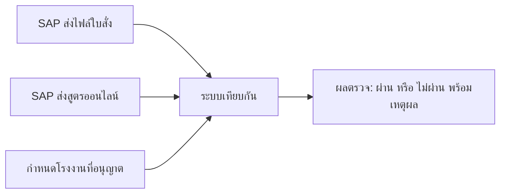
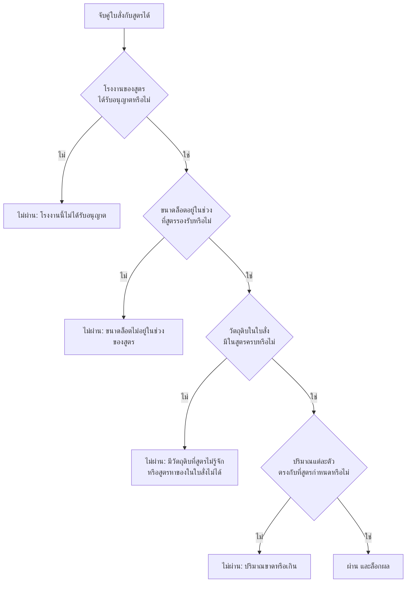

# การตรวจสูตรการผลิตอัตโนมัติ

เอกสารนี้สรุปให้ผู้บริหารเข้าใจว่า ระบบตรวจอะไร ผลแต่ละแบบหมายความว่าอย่างไร และทำไมใบสั่งแต่ละใบจึงได้ผลแบบนั้น ตัวเลขในตัวอย่างเป็นข้อมูลจริงจากระบบทดสอบ วันที่ 12 ต.ค. 2026

---

## สรุปสั้น

ระบบเทียบ **ใบสั่งผลิต** กับ **สูตรการผลิต** ของสินค้าตัวเดียวกัน โดยอัตโนมัติ ทุก 10 วินาที

- ถ้าวัตถุดิบครบและปริมาณตรง → **ผ่าน** และล็อกผลไว้
- ถ้าไม่ตรง → **ไม่ผ่าน** พร้อมบอกเหตุผลข้อแรกที่เจอ
- ถ้ายังไม่มีสูตรมาให้เทียบ → **ยังไม่ตรวจ** ไม่ถือว่าผิด

จุดที่ผู้บริหารต้องรู้: ระบบไม่ได้ผลิตเองและไม่ได้แก้ใบสั่ง มันแค่ตัดสินว่าใบสั่งใบนี้ใช้สูตรนี้ได้หรือไม่

---

## ข้อมูลมาจากสองทาง ต้องมีครบทั้งคู่

| | ใบสั่งผลิต | สูตรการผลิต |
|---|---|---|
| ใครส่ง | SAP ส่งเป็นไฟล์ | SAP ส่งเข้าระบบทางออนไลน์ |
| บอกอะไร | จะผลิตสินค้าอะไร กี่กิโล ใช้วัตถุดิบอะไร อย่างละเท่าไร กระบวนการไหน | สินค้านี้ กระบวนการนี้ ที่โรงงานนี้ ต้องใส่วัตถุดิบอะไร กี่เปอร์เซ็นต์ของล็อต |



ไฟล์เข้าสำเร็จไม่ได้แปลว่ามีผลตรวจ ถ้าสูตรของสินค้านั้นยังไม่มา ระบบจะรอ แล้วตรวจเองเมื่อสูตรมาถึง

---

## ระบบจับคู่ใบสั่งกับสูตรอย่างไร

ใบสั่งหนึ่งใบจับกับสูตรได้ฉบับเดียว เมื่อสองอย่างนี้ตรงกัน

1. **รหัสสินค้า** ในใบสั่ง ตรงกับรหัสสินค้าในสูตร
2. **รหัสกระบวนการ** ในใบสั่ง ตรงกับรหัสกระบวนการในสูตร

ถ้ารหัสสินค้าตรงแต่กระบวนการคนละแบบ ถือว่าคนละสูตร ไม่นำมาเทียบ

ถ้า SAP ส่งสูตรเดียวกันมาหลายครั้ง ระบบใช้ฉบับล่าสุด คู่ที่เคยตรวจแล้วจะไม่ตรวจซ้ำ แม้จะเปลี่ยนการตั้งค่าทีหลัง

---

## ระบบตัดสินเป็นลำดับ หยุดที่ข้อแรกที่ไม่ผ่าน



เพราะหยุดที่ข้อแรก ใบสั่งที่มีหลายปัญหาจะขึ้นเหตุผลเดียว แก้ข้อนั้นแล้วให้ตรวจใหม่ จึงจะเห็นข้อถัดไป

โรงงานที่อนุญาตตั้งค่าได้โดยไม่ต้องแก้โปรแกรม ตอนนี้ตั้งไว้ที่ **HHN** เท่านั้น สูตรของโรงงาน HH จะไม่ถูกคำนวณปริมาณ และได้ผลว่า `Plant HH is not allowed.`

รหัสโรงงานในไฟล์ใบสั่ง (เช่น 30) ไม่ได้ใช้ในการตัดสิน ระบบดูโรงงานที่ระบุในสูตร

---

## สูตรคำนวณ

ใช้เมื่อผ่านเรื่องโรงงาน ขนาดล็อต และรหัสวัตถุดิบแล้ว

**ปริมาณที่สูตรต้องการ ในแต่ละขั้นตอน**

```
ปริมาณที่ต้องใช้ = ขนาดล็อต × เปอร์เซ็นต์ในสูตร ÷ 100
```

ตัวอย่าง ล็อต 10,000 กิโลกรัม

| ขั้นตอนกำหนด | คำนวณ | ได้ |
|---|---|---|
| 22% | 10,000 × 22 ÷ 100 | 2,200 กก. |
| 2.09% | 10,000 × 2.09 ÷ 100 | 209 กก. |
| 0.0002% | 10,000 × 0.0002 ÷ 100 | 0.02 กก. = 20 กรัม |

**ส่วนต่างของวัตถุดิบแต่ละตัว**

```
ส่วนต่าง = ของที่มีในใบสั่ง − ของที่สูตรต้องการรวมทุกขั้นตอน
```

| ส่วนต่าง | ความหมาย |
|---|---|
| ต่างกันไม่เกิน 1 กรัม (0.001 กก.) | ตรง ถือว่าผ่าน |
| ติดลบมากกว่านั้น | ขาด ของในใบสั่งน้อยไป |
| เป็นบวกมากกว่านั้น | เกิน ของในใบสั่งมากไป |

มีขาดหรือเกินแม้ตัวเดียว ทั้งใบไม่ผ่าน

ข้อยกเว้น: ขั้นตอนที่สูตรระบุว่าเป็นขั้น **ปรับแต่งหน้างาน** ระบบตรวจแค่ว่ามีวัตถุดิบตัวนั้น ไม่ล็อกปริมาณ

หน่วยกรัมกับกิโลกรัมถูกแปลงให้ตรงกันก่อนเทียบ 20 กรัม = 0.02 กิโลกรัม

---

## ผลแต่ละแบบหมายความว่าอะไร

| ผลที่ขึ้นในระบบ | ความหมายทางธุรกิจ | ควรทำอย่างไร |
|---|---|---|
| ผ่าน (VALIDATED) | วัตถุดิบและปริมาณตรงสูตร ผลถูกล็อก | ใช้ผลิตได้ตามเกณฑ์นี้ |
| โรงงานไม่ได้รับอนุญาต | สูตรเป็นของโรงงานที่ยังไม่เปิดให้ตรวจ | ตรวจการตั้งค่าโรงงาน หรือยืนยันว่าสูตรถูกโรงงาน |
| ขนาดล็อตไม่อยู่ในช่วง | ล็อตเล็กหรือใหญ่กว่าที่สูตรรองรับ | ให้ฝ่ายสูตรหรือฝ่ายวางแผนตรวจขนาดล็อต |
| วัตถุดิบไม่ตรง | ใบสั่งมีตัวที่สูตรไม่มี หรือสูตรต้องการตัวที่ใบสั่งไม่มี | ให้ฝ่ายสูตรกับฝ่ายวางแผนเทียบรายการวัตถุดิบ |
| ปริมาณไม่ตรง | รหัสครบ แต่จำนวนขาดหรือเกิน | ดูว่ารายการในใบสั่งถูกส่งเข้าซ้ำหรือไม่ แล้วเทียบปริมาณ |
| ยังไม่มีผลตรวจ | ยังจับสูตรไม่ได้ | ตรวจว่าใบสั่งมีรหัสกระบวนการ และ SAP ส่งสูตรมาแล้วหรือยัง |

---

## ตัวอย่างจากข้อมูลจริง

### 1. ผ่าน — ใบสั่ง 80000003

ผลิตสินค้า 206.0202 จำนวน 10,000 กก. ด้วยกระบวนการ D-PC-2060202-Z-01 สูตรเป็นของโรงงาน HHN ซึ่งได้รับอนุญาต และรองรับล็อต 10,000–20,000 กก.

วัตถุดิบทุกตัวในใบสั่งมีในสูตร และปริมาณตรงทุกตัว เช่น

- สูตรต้องการ 22% ของ 10,000 = 2,200 กก. ใบสั่งมี 2,200 กก.
- สูตรต้องการ 0.0002% = 0.02 กก. ใบสั่งมี 20 กรัม ซึ่งเท่ากัน
- วัตถุดิบ 108993 ถูกใช้ 3 ขั้นตอน รวม 3 + 3 + 4 = 10 กก. ใบสั่งมี 10 กก.

ผล: **ผ่าน**

### 2. ไม่ผ่านเพราะโรงงาน — ใบสั่งทดสอบ TEST-HH-01

สินค้า 206.0202 จับสูตรได้ แต่สูตรระบุโรงงาน **HH** ขณะที่ระบบอนุญาตเฉพาะ HHN

ผล: **ไม่ผ่าน** ข้อความ `Plant HH is not allowed.` ระบบยังไม่ได้ไล่ปริมาณ

ถ้าเปิดให้โรงงาน HH ตรวจได้ ใบนี้ก็ยังไม่ผ่านในขั้นถัดไป เพราะล็อตมีแค่ 100 กก. แต่สูตรรองรับตั้งแต่ 3,500 กก.

### 3. ไม่ผ่านเพราะปริมาณเกิน — ใบสั่ง 80000001

สูตรเดียวกับใบที่ผ่าน ต้องการวัตถุดิบ 101003 จำนวน 209 กก. แต่ระบบเห็นในใบสั่ง 418 กก.

สาเหตุไม่ใช่สูตรผิด ใบสั่งเลขนี้ถูกส่งเข้ามา **สองครั้ง จากสองไฟล์** (13 ส.ค. และ 5 ต.ค.) ระบบรวมปริมาณของเลขใบสั่งเดียวกัน

```
209 + 209 = 418 กก. ในใบสั่ง
418 − 209 = เกิน 209 กก.
```

วัตถุดิบอีก 8 ตัวเกินเป็นสองเท่าเหมือนกัน ผลทั้งใบ: **ปริมาณไม่ตรง 9 รายการ**

### 4. ไม่ผ่านเพราะมีวัตถุดิบที่สูตรไม่รู้จัก — ใบสั่ง 81111113

ผลิตสินค้า 205.M50 ล็อต 10,000 กก. โรงงานของสูตรคือ HHN จึงได้ตรวจต่อ

ใบสั่งมีวัตถุดิบ 118003 จำนวน 18,406 กก. แต่สูตรของสินค้านี้ไม่มีขั้นตอนไหนใช้ 118003

ผล: **วัตถุดิบไม่ตรง** ข้อความ `Order code not in recipe: 118003`

วัตถุดิบตัวอื่นในใบนี้มีมากกว่าที่สูตรต้องการประมาณเท่าตัว ถ้าแก้เรื่อง 118003 แล้วตรวจใหม่ น่าจะเจอเรื่องปริมาณเกินต่อ

### 5. ไฟล์เข้าแล้ว แต่ไม่มีผลตรวจ — ชุดทดสอบ UAT

รับไฟล์เข้าครบ แต่ไม่มีผลตรวจ เพราะยังจับสูตรไม่ได้

| ใบสั่ง | สาเหตุ |
|---|---|
| 80280736, 80280737, 80278141, 80278152 | ใบสั่งไม่ได้ระบุรหัสกระบวนการ จึงไม่มีอะไรไปหาสูตร |
| 80271837, 80269751, 80275886 | มีรหัสกระบวนการแล้ว แต่ SAP ยังไม่ส่งสูตรของสินค้า 031.O20 และ 20A.190 |

เมื่อสูตรของสินค้าเหล่านี้เข้ามา ระบบจะตรวจให้เองในรอบถัดไป

### 6. ส่งไฟล์เดิมเข้าซ้ำ ผลที่เคยผ่านกลายเป็นไม่ผ่าน

วันที่ 12 ต.ค. 2026 เวลา 13:53 มีการนำไฟล์ใบสั่งชุดเดิมเข้าอีกครั้ง

ใบสั่ง 80000003 และ 80000004 ที่วันที่ 9 ต.ค. **ผ่าน** ถูกตรวจใหม่แล้วได้ผล **ปริมาณไม่ตรง** เพราะปริมาณถูกบวกเพิ่มอีกหนึ่งชุด

ผลเก่าไม่ได้ถูกลบ ถูกเปลี่ยนเป็นผลที่ไม่ใช่ปัจจุบัน ผลปัจจุบันคือปริมาณเกิน

ก่อนทดสอบซ้ำ ต้องลบใบสั่งที่เข้าซ้ำและผลตรวจเดิมออกก่อน ไม่อย่างนั้นตัวเลขจะเบิ้ลทุกครั้งที่ส่งไฟล์เดิมเข้ามา

---

## สิ่งที่ควรจำ

| สิ่งที่เห็น | ความหมาย |
|---|---|
| ไฟล์เข้าแล้ว แต่ไม่มีผล | ยังไม่มีสูตรให้เทียบ หรือใบสั่งไม่มีรหัสกระบวนการ |
| ขึ้นเรื่องโรงงาน | สูตรเป็นของโรงงานที่ยังไม่เปิดให้ตรวจ ไม่ได้ดูรหัสโรงงานในไฟล์ใบสั่ง |
| ปริมาณเกินเท่าตัวทุกตัว | มักมาจากการส่งใบสั่งเลขเดิมเข้ามากกว่าหนึ่งครั้ง |
| ขึ้นวัตถุดิบตัวหนึ่ง | ใบสั่งมีตัวที่สูตรไม่มี ระบบยังไม่ไล่ปริมาณในรอบนั้น |
| เปลี่ยนการตั้งค่าแล้วผลเดิมไม่ขยับ | คู่ที่ตรวจแล้วจะไม่ตรวจใหม่ ต้องลบผลเดิมก่อน |
| ใบสั่งยังสถานะเดิม | ระบบไม่แก้ใบสั่ง ให้ดูที่ผลตรวจ |
