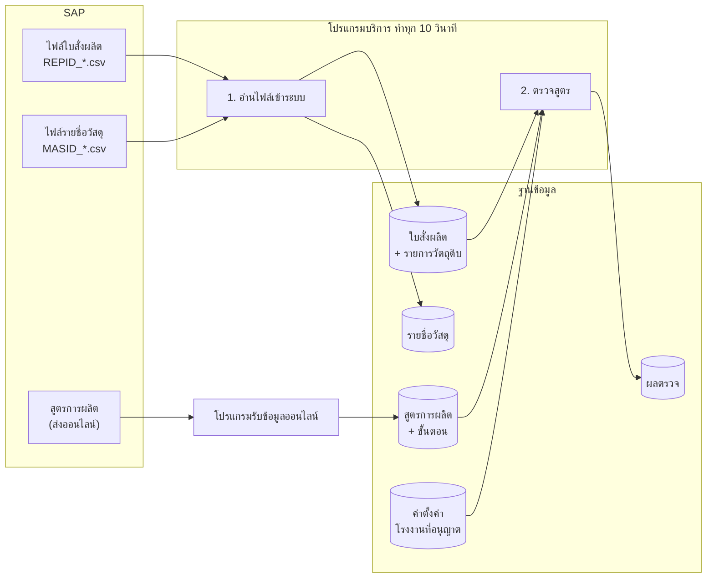
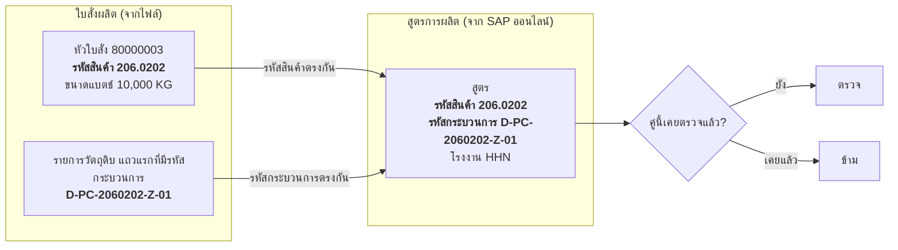
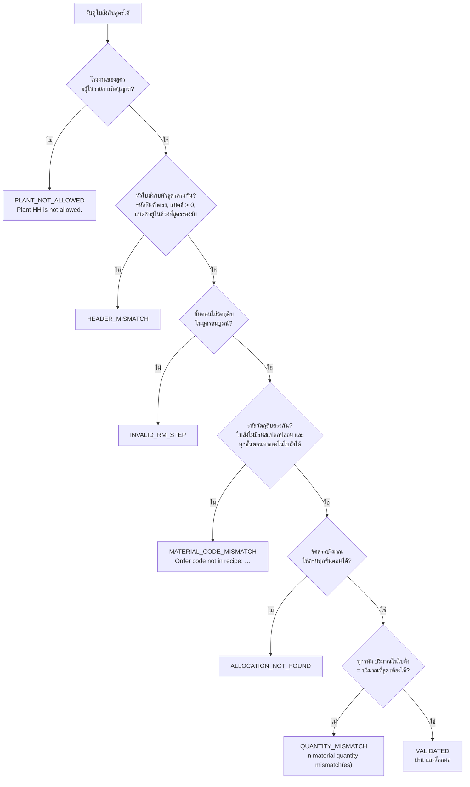
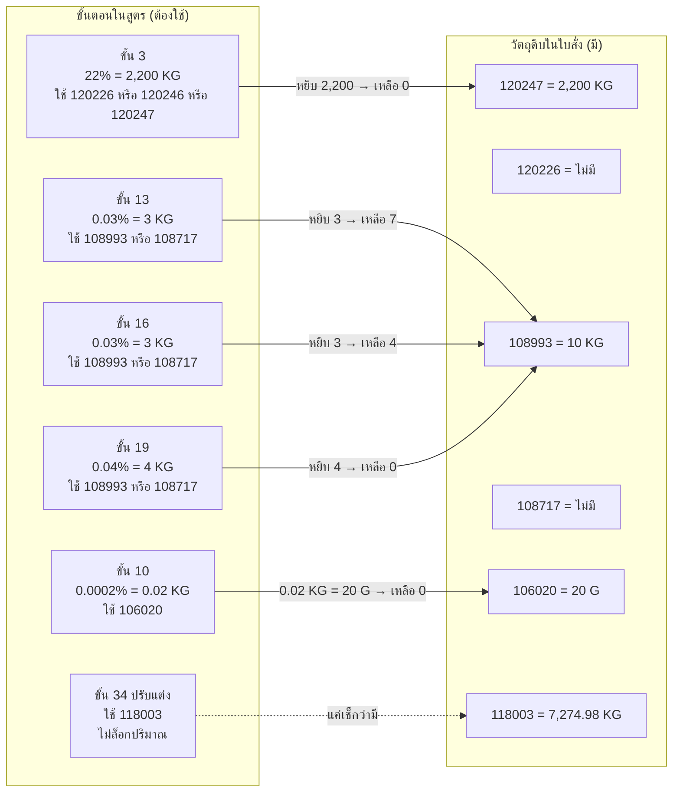
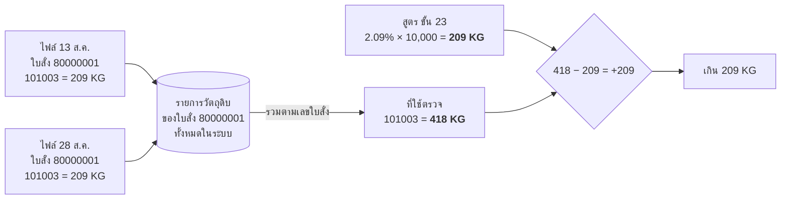

# การตรวจสูตรอัตโนมัติ (Batch Validation) ทำงานอย่างไร

เอกสารนี้อธิบายให้คนที่ไม่ได้เขียนโปรแกรมเข้าใจว่า ระบบเอาข้อมูลอะไรเข้ามา เอาไปเทียบกับอะไร ตัดสินด้วยกฎอะไร และทำไมผลตรวจแต่ละใบจึงออกมาแบบนั้น ตัวอย่างทั้งหมดเป็นข้อมูลจริงจากระบบทดสอบ ณ วันที่ 12 ต.ค. 2026

---

## 1. ภาพรวม: ของสองทางมาเจอกัน

การตรวจสูตรต้องมีของ 2 อย่างมาเจอกัน

| | ใบสั่งผลิต | สูตรการผลิต |
|---|---|---|
| **มาจากไหน** | SAP ส่งเป็นไฟล์ชื่อขึ้นต้น `REPID_` มาวางไว้ในโฟลเดอร์รับไฟล์ | SAP ส่งตรงมาให้ระบบผ่านช่องทางออนไลน์ (API) |
| **ใครรับเข้า** | โปรแกรมบริการ (NEOService) หยิบไฟล์ไปอ่านทุก 10 วินาที | โปรแกรมรับข้อมูล (NEO API) รับแล้วเก็บทันที |
| **บอกอะไร** | จะผลิตสินค้าตัวไหน กี่กิโล ใช้วัตถุดิบอะไรบ้าง อย่างละเท่าไร และใช้กระบวนการไหน | สินค้าตัวนี้ ผลิตด้วยกระบวนการนี้ ที่โรงงานนี้ ต้องใส่วัตถุดิบอะไร ขั้นตอนไหน กี่เปอร์เซ็นต์ของแบตช์ |

นอกจากนี้ยังมีไฟล์ `MASID_` (รายชื่อวัสดุ) ที่ระบบรับเข้าเช่นกัน แต่ไม่เกี่ยวกับการตรวจสูตร

**จุดสำคัญ** ใบสั่งมาทางไฟล์ สูตรมาทางออนไลน์ ถ้าใบสั่งเข้ามาแล้วแต่ SAP ยังไม่เคยส่งสูตรของสินค้าตัวนั้น จะยังไม่มีผลตรวจ และกลับกันก็เช่นเดียวกัน

---

## 2. ขั้นที่ 1 – รับไฟล์ใบสั่งเข้าระบบ

1. โปรแกรมบริการมองเข้าไปในโฟลเดอร์รับไฟล์ทุก 10 วินาที
2. ไฟล์ใหม่จะยังไม่ถูกอ่านทันที ต้องเห็นว่า **ขนาดไฟล์เท่าเดิมติดกัน 2 รอบ** ก่อน เพื่อให้แน่ใจว่า SAP เขียนไฟล์เสร็จแล้ว
3. อ่านทั้งไฟล์แล้วบันทึกทั้งหมดในครั้งเดียว ถ้ามีบรรทัดไหนผิดจนบันทึกไม่ได้ จะยกเลิกทั้งไฟล์ ไม่มีครึ่ง ๆ กลาง ๆ
4. ไฟล์ที่สำเร็จย้ายไปโฟลเดอร์ `Success` ไฟล์ที่ผิดพลาดย้ายไป `Error`

ในไฟล์ใบสั่ง 1 บรรทัด = วัตถุดิบ 1 รายการ แต่ละบรรทัดมีข้อมูลหัวใบสั่งซ้ำอยู่ด้วย ระบบจึงแยกเก็บเป็น

- **หัวใบสั่ง** (เลขใบสั่ง, รหัสสินค้าที่จะผลิต, ขนาดแบตช์ เช่น 10,000 KG, เลข batch) — 1 แถวต่อใบ
- **รายการวัตถุดิบ** (รหัสวัตถุดิบ, ปริมาณที่ต้องใช้, หน่วย, รหัสกระบวนการ, สถานะลบ) — หลายแถวต่อใบ

**ข้อควรรู้** ระบบ **ไม่กันใบสั่งซ้ำ** ถ้าไฟล์เดิมถูกวางเข้ามาอีกรอบ ใบสั่งเลขเดิมจะถูกบันทึกเพิ่มอีกชุด (ดูผลกระทบในตัวอย่าง C และ F)

---

## 3. ขั้นที่ 2 – จับคู่ใบสั่งกับสูตร

ระบบไล่ใบสั่งทีละใบ ทำแบบนี้

1. หยิบใบสั่งที่ยังใช้งานอยู่
2. ดูรายการวัตถุดิบของใบนั้น เรียงตามลำดับที่บันทึก เอา **แถวแรกที่มีรหัสกระบวนการ** มาใช้เป็นรหัสกระบวนการของใบสั่ง
3. ไปค้นสูตรที่
   - **รหัสสินค้าของสูตร** ตรงกับ **รหัสสินค้าที่จะผลิต** ในใบสั่ง
   - **รหัสกระบวนการของสูตร** ตรงกับรหัสกระบวนการที่ได้จากข้อ 2
   - สูตรยังใช้งานอยู่ (ไม่ถูกยกเลิก)
4. ถ้าเจอสูตรหลายฉบับที่ตรงกันหมด (SAP ส่งซ้ำ) เลือกฉบับเดียว: วันที่มีผลใหม่สุด → เลขแก้ไข (Revision) มากสุด → ฉบับที่เข้ามาหลังสุด
5. ดูว่าคู่ "ใบสั่งใบนี้ + สูตรฉบับนี้" **เคยตรวจแล้วหรือยัง** ถ้าเคยแล้วข้าม ถ้ายังไม่เคยจึงตรวจ

สิ่งที่ตามมาจากกฎนี้

- ใบสั่งที่ **ไม่มีรหัสกระบวนการ** เลยสักแถว → ไม่มีอะไรไปค้นสูตร → **ไม่ถูกตรวจ และไม่มีผลตรวจ**
- ใบสั่งที่มีรหัสกระบวนการ แต่ SAP **ยังไม่เคยส่งสูตร** ของสินค้า+กระบวนการนั้น → ไม่ถูกตรวจเช่นกัน ไม่ใช่ความผิดพลาด แค่ยังไม่มีสูตรให้เทียบ พอสูตรเข้ามารอบถัดไปจะตรวจให้เอง
- ผลตรวจที่เคยบันทึกแล้ว **จะไม่ถูกตรวจซ้ำ** แม้จะเปลี่ยนค่าตั้งค่าภายหลังก็ตาม ถ้าต้องการให้ตรวจใหม่ต้องลบผลเดิมก่อน
- การวางไฟล์เดิมเข้ามาซ้ำ ทำให้ได้ใบสั่งชุดใหม่ ซึ่งนับเป็นคู่ใหม่ จึงถูกตรวจอีกครั้ง

---

## 4. ขั้นที่ 3 – เตรียมข้อมูล 4 ส่วน

เมื่อจับคู่ได้แล้ว ระบบดึงข้อมูลมาเตรียมไว้

| ส่วน | เอามาจาก | ใช้อะไรบ้าง |
|---|---|---|
| หัวใบสั่ง | ใบสั่ง | ขนาดแบตช์, หน่วย (เช่น KG), รหัสสินค้า |
| รายการวัตถุดิบของใบสั่ง | ใบสั่ง | รวมปริมาณตามรหัสวัตถุดิบ **โดยตัดแถวที่ SAP ติดสถานะ "ลบ" ออก** และ **รวมทุกแถวที่เลขใบสั่งเดียวกัน** ไม่ว่าจะมาจากไฟล์ไหน |
| หัวสูตร | สูตร | โรงงาน, รหัสสินค้า, ขนาดแบตช์ต่ำสุด–สูงสุดที่สูตรรองรับ, หน่วย |
| ขั้นตอนของสูตร | สูตร | ทุกขั้นตอนที่ยังใช้งาน เรียงตามลำดับขั้น |

---

## 5. ขั้นที่ 4 – กรองโรงงาน (Plant) ก่อนทำอย่างอื่น

มีค่าตั้งค่าในระบบชื่อ **"โรงงานที่อนุญาตให้ตรวจสูตร"** ซึ่งผู้ดูแลระบบแก้ได้โดยไม่ต้องแก้โปรแกรม

| ค่าที่ตั้งไว้ | ผล |
|---|---|
| ว่าง | ไม่กรอง ตรวจทุกโรงงาน |
| `HHN` | ตรวจเฉพาะสูตรของโรงงาน HHN |
| `HH, HHN` | ตรวจทั้งสองโรงงาน (คั่นด้วยจุลภาค ไม่สนตัวพิมพ์เล็กใหญ่) |

**ค่าที่เอามาเทียบคือโรงงานที่ระบุในสูตร** ไม่ใช่รหัสโรงงานในไฟล์ใบสั่ง (ไฟล์ใบสั่งจาก SAP ใส่รหัสโรงงานเป็นตัวเลขเช่น `30` ซึ่งเป็นคนละระบบรหัส)

ถ้าโรงงานของสูตร **ไม่อยู่** ในรายการที่อนุญาต ระบบจะ **บันทึกผลตรวจ 1 แถว** ว่าไม่ผ่าน พร้อมข้อความ `Plant HH is not allowed.` และหยุดตรงนั้น ไม่เทียบรหัส ไม่คำนวณปริมาณ ไม่มีรายละเอียดรายขั้นตอน

ค่าที่ตั้งอยู่ตอนนี้: `HHN`

---

## 6. ขั้นที่ 5 – ตรวจหัวใบสั่งกับหัวสูตร

ถ้าไม่ผ่านข้อใดข้อหนึ่ง ผลเป็น **HEADER_MISMATCH** และไม่คำนวณต่อ

| กฎ | ข้อความที่บันทึก |
|---|---|
| รหัสสินค้าของสูตร ≠ รหัสสินค้าในใบสั่ง | `BulkCode mismatch: Order=… Recipe=…` |
| ขนาดแบตช์เป็น 0 หรือติดลบ | `TargetQty / BatchQty must be greater than 0` |
| สูตรไม่มีขั้นตอนเลย | `Process step not found` |
| ขนาดแบตช์ **น้อยกว่า** ขั้นต่ำที่สูตรรองรับ | `BatchQty 100 is below BatchSizeMin 3500` |
| ขนาดแบตช์ **มากกว่า** ขั้นสูงที่สูตรรองรับ | `BatchQty … exceeds BatchSizeMax …` |

หน่วยที่ใช้คำนวณทั้งหมด = หน่วยของขนาดแบตช์ในใบสั่ง (ปกติ KG)

---

## 7. ขั้นที่ 6 – หาว่าขั้นตอนไหนของสูตรเป็น "ขั้นตอนใส่วัตถุดิบ"

สูตร 1 ฉบับมีหลายสิบขั้นตอน (ผสม, ให้ความร้อน, ตรวจค่า, ใส่วัตถุดิบ ฯลฯ) ระบบสนใจเฉพาะ **ขั้นตอนใส่วัตถุดิบ** ซึ่งดูจากช่องข้อมูลของขั้นตอนที่ SAP ส่งมา

- ช่องชนิดเขียนว่า **"RM Code"** และช่องหน่วยเขียนว่า **"%RM"**
- ช่องรหัสวัตถุดิบ บอกว่าขั้นตอนนี้ใช้รหัสอะไรได้บ้าง ถ้ามีหลายรหัสคั่นด้วย `|` แปลว่า **ใช้ตัวใดตัวหนึ่งก็ได้** (เช่น `120226|120246|120247` = วัตถุดิบทดแทนกันได้)
- ช่องเปอร์เซ็นต์ บอกว่าต้องใส่กี่ % ของขนาดแบตช์

ขั้นตอนใส่วัตถุดิบมี 2 แบบ

| แบบ | ดูจาก | ระบบตรวจอะไร |
|---|---|---|
| **กำหนด %** (FIXED_PERCENT) | ช่องเปอร์เซ็นต์มีตัวเลข | ตรวจทั้งรหัสและปริมาณ: **ปริมาณที่ต้องใช้ = ขนาดแบตช์ × % ÷ 100** |
| **ปรับแต่ง** (ADJUST) | ช่องเปอร์เซ็นต์ว่าง และชื่อขั้นตอนมีคำว่า ADJUST | ตรวจแค่ว่ามีรหัสนี้ในใบสั่ง ไม่ล็อกปริมาณ เพราะเป็นของที่เติมตามหน้างาน |

ขั้นตอนอื่นที่ไม่ใช่การใส่วัตถุดิบ ระบบเก็บไว้เป็นบันทึกอ้างอิงเฉย ๆ ไม่มีผลต่อการตัดสิน

ถ้าเป็นขั้นตอนใส่วัตถุดิบแต่ช่องรหัสว่าง หรือเป็นแบบกำหนด % แต่ช่องเปอร์เซ็นต์ไม่ใช่ตัวเลข → ผลเป็น **INVALID_RM_STEP** (สูตรที่ส่งมาไม่สมบูรณ์)

---

## 8. ขั้นที่ 7 – เทียบรหัสวัตถุดิบ

เอารหัสที่ใช้ได้จากทุกขั้นตอนใส่วัตถุดิบมารวมเป็น **"รายชื่อรหัสที่สูตรรู้จัก"** แล้วเทียบสองทาง

1. **ใบสั่งมีรหัสที่สูตรไม่รู้จักไหม** — วัตถุดิบในใบสั่งที่มีปริมาณ แต่ไม่อยู่ในรายชื่อเลย → `Order code not in recipe: 118003`
2. **สูตรมีขั้นตอนที่หาของในใบสั่งไม่ได้ไหม** — ขั้นตอนที่รหัสทุกตัวในช่องรหัสไม่มีในใบสั่งเลย → `Recipe step has no BOM candidate: …`

เจอข้อใดข้อหนึ่ง → ผลเป็น **MATERIAL_CODE_MISMATCH** และไม่คำนวณปริมาณต่อ

---

## 9. ขั้นที่ 8 – จัดสรรและเทียบปริมาณ

ทำเฉพาะเมื่อผ่านทุกข้อข้างบน

1. **แปลงหน่วยให้ตรงกัน** ปริมาณในใบสั่งทุกรหัสถูกแปลงเป็นหน่วยของแบตช์ (KG) — กรัมหาร 1,000 มิลลิกรัมหาร 1,000,000
2. **แต่ละขั้นตอนแบบกำหนด % ต้อง "หยิบ" ของจากใบสั่ง** ตามปริมาณที่ต้องใช้ จากรหัสใดรหัสหนึ่งที่ขั้นตอนนั้นอนุญาต
3. ระบบลองจับคู่ขั้นตอน → รหัส ให้ครบทุกขั้น โดยเริ่มจากขั้นตอนที่มีตัวเลือกน้อยสุดก่อน และห้ามหยิบเกินของที่เหลือในใบสั่ง (ยอมคลาดเคลื่อนได้ 0.001)
   - จับคู่ได้ครบ → ไปข้อ 4
   - จับคู่ไม่ได้เลย → **ALLOCATION_NOT_FOUND**
4. **เทียบรายรหัส** ของในใบสั่ง − ของที่สูตรต้องใช้รวมทุกขั้นตอน
   - ต่างกันไม่เกิน 0.001 → **ตรง** (MATCH)
   - ใบสั่งน้อยกว่า → **ขาด** (SHORTAGE)
   - ใบสั่งมากกว่า → **เกิน** (EXCESS)
   - มีขาดหรือเกินอย่างน้อย 1 รหัส → ผลรวมเป็น **QUANTITY_MISMATCH**
5. รหัสที่อยู่เฉพาะในขั้นตอนแบบปรับแต่ง (ADJUST) ไม่ถูกเทียบปริมาณ

ผ่านครบทุกข้อ → **VALIDATED**

---

## 10. ลำดับการตัดสินทั้งหมดในภาพเดียว

ระบบจะหยุดที่ข้อแรกที่ไม่ผ่าน ดังนั้นถ้าใบสั่งหนึ่งมีปัญหาหลายอย่าง จะเห็นแค่เหตุผลแรกเท่านั้น แก้แล้วตรวจใหม่จึงอาจเจอเหตุผลถัดไป

---

## 11. ขั้นที่ 9 – บันทึกผล

ผลตรวจ 1 แถวต่อคู่ (ใบสั่ง, สูตร) ประกอบด้วย

| ชื่อผล | ความหมาย | สถานะ | ล็อกผล |
|---|---|---|---|
| VALIDATED | ผ่านทุกข้อ | ผ่าน (1) | ใช่ |
| PLANT_NOT_ALLOWED | โรงงานไม่อยู่ในรายการที่อนุญาต | ไม่ผ่าน (2) | ไม่ |
| HEADER_MISMATCH | หัวใบสั่งกับหัวสูตรไม่ตรง | ไม่ผ่าน (2) | ไม่ |
| INVALID_RM_STEP | สูตรที่ส่งมาไม่สมบูรณ์ | ไม่ผ่าน (2) | ไม่ |
| MATERIAL_CODE_MISMATCH | รหัสวัตถุดิบไม่ตรง | ไม่ผ่าน (2) | ไม่ |
| ALLOCATION_NOT_FOUND | จัดสรรปริมาณไม่ลงตัว | ไม่ผ่าน (2) | ไม่ |
| QUANTITY_MISMATCH | รหัสครบแต่ปริมาณขาด/เกิน | ไม่ผ่าน (2) | ไม่ |

พร้อมรายละเอียด 2 ระดับ

- **รายขั้นตอนของสูตร** — ขั้นตอนนี้เลือกรหัสไหน ต้องใช้เท่าไร ของในใบสั่งก่อน/หลังหยิบเหลือเท่าไร
- **รายรหัสวัตถุดิบ** — รหัสนี้ใบสั่งมีเท่าไร สูตรต้องใช้เท่าไร ต่างกันเท่าไร ตรง/ขาด/เกิน

ปริมาณที่แสดงจะแปลงกลับเป็นหน่วยเดิมของใบสั่ง (เช่นถ้าใบสั่งระบุเป็นกรัม ก็แสดงเป็นกรัม) ถ้าใบสั่งเดิมเคยมีผล ผลเก่าจะถูกทำเครื่องหมายว่า "ไม่ใช่ปัจจุบัน" และผลใหม่เป็นปัจจุบัน สถานะของตัวใบสั่งเองไม่ถูกเปลี่ยน ให้ดูที่ผลตรวจเท่านั้น

---

## 12. ตัวอย่างจริง

### ตัวอย่าง A – ถูกกรองด้วยโรงงาน → PLANT_NOT_ALLOWED

**ไฟล์เข้า** `REPID_TEST_PLANT_HH.csv` วางเข้าระบบ 12 ต.ค. 2026 เวลา 13:59

| ใบสั่ง | รหัสสินค้า | ขนาดแบตช์ | รหัสกระบวนการ |
|---|---|---|---|
| TEST-HH-01 | 206.0202 | 100 KG | D-PC-2060202-A-05 |
| TEST-HH-02 | 20A.310 | 100 KG | D-PC-20A310-C-03 |

**จับคู่** ใบ TEST-HH-01 ค้นสูตรที่รหัสสินค้า 206.0202 และกระบวนการ D-PC-2060202-A-05 → พบ 3 ฉบับ (SAP ส่งสูตรเดียวกันซ้ำ 3 ครั้ง) เลือกฉบับที่เข้ามาหลังสุด ทุกฉบับระบุโรงงาน **HH**

**กรองโรงงาน** ค่าที่ตั้งไว้คือ `HHN` → HH ไม่อยู่ในรายการ → หยุดทันที

**ผลที่บันทึก**

| ใบสั่ง | โรงงานของสูตร | ผล | ข้อความ | ล็อกผล |
|---|---|---|---|---|
| TEST-HH-01 | HH | PLANT_NOT_ALLOWED | Plant HH is not allowed. | ไม่ |
| TEST-HH-02 | HH | PLANT_NOT_ALLOWED | Plant HH is not allowed. | ไม่ |

ไม่มีรายละเอียดรายขั้นตอนและรายรหัส เพราะยังไม่ได้คำนวณ

**ข้อสังเกต** ต่อให้โรงงาน HH ได้รับอนุญาต ใบนี้ก็ยังไม่ผ่าน เพราะขนาดแบตช์ 100 KG น้อยกว่าขั้นต่ำของสูตร 3,500 KG จะได้ HEADER_MISMATCH แทน แต่เพราะการกรองโรงงานทำก่อน จึงเห็นเหตุผลเดียว

---

### ตัวอย่าง B – ผ่านทุกข้อ → VALIDATED

**ใบสั่ง** 80000003 จากไฟล์ `REPID_2026082811272843_2.csv` รหัสสินค้า 206.0202 ขนาดแบตช์ **10,000 KG** รหัสกระบวนการ D-PC-2060202-Z-01 (ตรวจเมื่อ 9 ต.ค. 2026)

**สูตรที่จับได้** รหัสสินค้า 206.0202 กระบวนการ D-PC-2060202-Z-01 โรงงาน **HHN** รองรับแบตช์ 10,000–20,000 KG มี 36 ขั้นตอน

**กรองโรงงาน** HHN อนุญาต → ตรวจต่อ

**หัวใบสั่ง** รหัสสินค้าตรง, 10,000 อยู่ในช่วง 10,000–20,000, มีขั้นตอน → ผ่าน

**วัตถุดิบในใบสั่ง (10 รหัส)**

| รหัส | ปริมาณ |
|---|---|
| 101003 | 209 KG |
| 106020 | 20 G |
| 108993 | 10 KG |
| 109262 | 120 KG |
| 116021 | 10 KG |
| 118003 | 7,274.98 KG |
| 120219 | 50 KG |
| 120222 | 100 KG |
| 120227 | 26 KG |
| 120247 | 2,200 KG |

**ขั้นตอนใส่วัตถุดิบในสูตร (13 ขั้นจาก 36)** และปริมาณที่ต้องใช้ = 10,000 × % ÷ 100

| ขั้นที่ | รหัสที่ใช้ได้ | % | แบบ | ต้องใช้ |
|---|---|---|---|---|
| 3 | 120226 หรือ 120246 หรือ 120247 | 22 | กำหนด % | 2,200 KG |
| 4 | 120222 | 1 | กำหนด % | 100 KG |
| 5 | 120219 | 0.5 | กำหนด % | 50 KG |
| 6 | 116021 | 0.1 | กำหนด % | 10 KG |
| 7 | 109262 | 1.2 | กำหนด % | 120 KG |
| 8 | 120227 | 0.26 | กำหนด % | 26 KG |
| 10 | 106020 | 0.0002 | กำหนด % | 0.02 KG = 20 G |
| 13 | 108993 หรือ 108717 | 0.03 | กำหนด % | 3 KG |
| 16 | 108993 หรือ 108717 | 0.03 | กำหนด % | 3 KG |
| 19 | 108993 หรือ 108717 | 0.04 | กำหนด % | 4 KG |
| 23 | 101003 | 2.09 | กำหนด % | 209 KG |
| 34 | 118003 | ว่าง (ADJUST) | ปรับแต่ง | ไม่ล็อก |
| 35 | 101003 | ว่าง (ADJUST) | ปรับแต่ง | ไม่ล็อก |

**เทียบรหัส**

- ทุกรหัสในใบสั่งอยู่ในรายชื่อที่สูตรรู้จัก (118003 อยู่ในขั้นที่ 34 แบบปรับแต่ง จึงไม่ถือว่าแปลกปลอม)
- ทุกขั้นตอนหาของในใบสั่งได้ (ขั้น 3 มี 120247, ขั้น 13/16/19 มี 108993)

**จัดสรรปริมาณ** – ภาพการ "หยิบ" ของจากใบสั่งตามขั้นตอน

- ขั้น 3 มีทางเลือก 3 รหัส แต่ใบสั่งมีแค่ 120247 (2,200 KG) → หยิบ 120247 พอดี เหลือ 0
- ขั้น 13, 16, 19 ใช้ 108993 ร่วมกัน 3 + 3 + 4 = 10 KG → ใบสั่งมี 10 KG → เหลือ 0 พอดี
- ขั้น 10 ต้องใช้ 0.02 KG → ใบสั่งมี 20 G = 0.02 KG → ตรง (แสดงผลกลับเป็น 20 G)
- รหัสอื่น ต้องใช้เท่ากับที่มีทุกตัว

**เทียบรายรหัส** 9 รหัส ต่างกัน 0 ทุกตัว → ตรงหมด (118003 ไม่ถูกเทียบ เพราะอยู่แค่ในขั้นตอนปรับแต่ง)

**ผล** VALIDATED – `All MaterialCode and Quantity matched` – ผ่าน – ล็อกผล

---

### ตัวอย่าง C – รหัสครบแต่ปริมาณเกิน → QUANTITY_MISMATCH

**ใบสั่ง** 80000001 รหัสสินค้า 206.0202 ขนาดแบตช์ 10,000 KG รหัสกระบวนการ D-PC-2060202-B-01 → สูตรโรงงาน HHN ขั้นตอนใส่วัตถุดิบเหมือนตัวอย่าง B ทุกข้อ

**ทำไมถึงเกิน** ใบสั่งเลข 80000001 ถูกวางเข้าระบบ **2 ครั้ง จาก 2 ไฟล์**

| ไฟล์ | วันที่เข้า | รายการ |
|---|---|---|
| REPID_2026081311272843_2.csv | 14 ส.ค. 2026 | 10 แถว |
| REPID_2026082811272843_2.csv | 5 ต.ค. 2026 | 10 แถว |

ตอนเตรียมข้อมูล ระบบ **รวมปริมาณจากทุกแถวที่เลขใบสั่งเดียวกัน** โดยไม่แยกว่ามาจากไฟล์ไหน ปริมาณทุกรหัสจึงกลายเป็น 2 เท่า

| รหัส | สูตรต้องใช้ | ใบสั่งมี (รวม 2 ไฟล์) | ต่าง | ผล |
|---|---|---|---|---|
| 120247 | 2,200 KG | 4,400 KG | +2,200 | เกิน |
| 101003 | 209 KG | 418 KG | +209 | เกิน |
| 106020 | 20 G | 40 G | +20 | เกิน |
| 108993 | 10 KG | 20 KG | +10 | เกิน |
| อีก 5 รหัส | | เป็น 2 เท่าทุกตัว | | เกิน |

การหยิบของทำได้ครบทุกขั้น (ของมีพอ) แต่พอเทียบรายรหัสแล้วเหลือเกิน → เกิน 9 รหัส

**ผล** QUANTITY_MISMATCH – `9 material quantity mismatch(es)` – ไม่ผ่าน – ไม่ล็อก

---

### ตัวอย่าง D – ใบสั่งมีวัตถุดิบที่สูตรไม่รู้จัก → MATERIAL_CODE_MISMATCH

**ใบสั่ง** 81111113 รหัสสินค้า 205.M50 ขนาดแบตช์ 10,000 KG รหัสกระบวนการ D-PC-205M50-B-02 → สูตรโรงงาน HHN มี 86 ขั้นตอน

**วัตถุดิบในใบสั่ง**

| รหัส | ปริมาณ |
|---|---|
| 104090 | 1,000 KG |
| 108972 | 540 KG |
| 108975 | 30 KG |
| 116057 | 4 KG |
| 118003 | 18,406 KG |
| 120217 | 20 KG |

**ขั้นตอนใส่วัตถุดิบในสูตร (8 ขั้น)**

| ขั้นที่ | รหัสที่ใช้ได้ | % |
|---|---|---|
| 1 | 104067 หรือ 104090 | 2.5 |
| 2 | 104067 หรือ 104090 หรือ 104064 | 2.5 |
| 14, 25, 36 | 108975 | 0.05 ต่อขั้น |
| 46 | 108972 | 2.7 |
| 47 | 120217 | 0.1 |
| 78 | 116057 | 0.02 |

รายชื่อรหัสที่สูตรรู้จัก = 104067, 104090, 104064, 108975, 108972, 120217, 116057 → **ไม่มี 118003** และสูตรนี้ไม่มีขั้นตอนปรับแต่งสำหรับ 118003 แบบสูตรในตัวอย่าง B

**เทียบรหัส** ใบสั่งมี 118003 จำนวน 18,406 KG แต่สูตรไม่รู้จัก → `Order code not in recipe: 118003`

พอรหัสไม่ผ่าน ระบบไม่คำนวณจัดสรร ในรายละเอียดรายรหัส 118003 จะถูกทำเครื่องหมาย "ไม่อยู่ในสูตร" ส่วนอีก 5 รหัสตรง

**ผล** MATERIAL_CODE_MISMATCH – ไม่ผ่าน – ไม่ล็อก

หมายเหตุ: ปริมาณรวมในใบนี้ ≈ 20,000 KG แต่ขนาดแบตช์ 10,000 KG (เช่น 104090 มี 1,000 KG แต่สูตรต้องใช้ 2.5% + 2.5% = 500 KG) ถ้าแก้เรื่องรหัสได้ ใบนี้จะไปเจอปัญหาปริมาณเกินต่อ

---

### ตัวอย่าง E – ไฟล์ทดสอบ UAT เข้าระบบแล้วแต่ไม่มีผลตรวจ

ไฟล์ใบสั่ง 6 ไฟล์ในชุด UAT รับเข้าสำเร็จทุกไฟล์ (ย้ายไป Success) แต่ไม่มีผลตรวจเลยสักใบ เพราะ

| ใบสั่ง | รหัสสินค้า | รหัสกระบวนการ | เหตุผล |
|---|---|---|---|
| 80280736, 80280737, 80278141, 80278152 | 035.0A0 / 031.HA01 | **ว่างทุกแถว** | ไม่มีรหัสไปค้นสูตร |
| 80271837 | 031.O20 | D-PC-031O20-4000-03 | SAP ยังไม่เคยส่งสูตรของ 031.O20 |
| 80269751 | 20A.190 | D-PC-20A190-C-03 | SAP ยังไม่เคยส่งสูตรของ 20A.190 |
| 80275886 | 20A.190 | D-PC-20A190-B-03 | SAP ยังไม่เคยส่งสูตรของ 20A.190 |

"รับไฟล์เข้า" กับ "ตรวจสูตร" เป็นคนละขั้น รับเข้าสำเร็จไม่ได้แปลว่ามีผลตรวจ ถ้า SAP ส่งสูตรของสินค้าเหล่านี้เข้ามาภายหลัง ระบบจะจับคู่และตรวจให้เองในรอบถัดไป

---

### ตัวอย่าง F – วางไฟล์เดิมเข้าซ้ำ ทำให้ผลเปลี่ยน

วันที่ 12 ต.ค. 2026 เวลา 13:53 ไฟล์ `REPID_2026082811272843_2.csv` ถูกวางเข้าระบบอีกครั้ง สิ่งที่เกิดขึ้น

1. ได้ใบสั่งชุดใหม่ 8 ใบ (เลขเดิม) ซึ่งนับเป็นคู่ใหม่กับสูตรเดิม → ถูกตรวจทันที
2. ปริมาณวัตถุดิบถูกรวมจากทุกครั้งที่เลขใบสั่งเดียวกันเคยเข้า → ใบ 80000003 ตอนนี้มี 2 ชุด ปริมาณเป็น 2 เท่า

| ใบสั่ง | ผลครั้งก่อน (9 ต.ค.) | ผลครั้งใหม่ (12 ต.ค.) | เหตุ |
|---|---|---|---|
| 80000003 | VALIDATED | QUANTITY_MISMATCH 9 รหัส | ปริมาณ ×2 จากการเข้าซ้ำ |
| 80000004 | VALIDATED | QUANTITY_MISMATCH | เหตุเดียวกัน |
| 80000001 | QUANTITY_MISMATCH | QUANTITY_MISMATCH | ตอนนี้ ×3 แล้ว |
| 81111111–81111114 | MATERIAL_CODE_MISMATCH | MATERIAL_CODE_MISMATCH | 118003 ยังไม่อยู่ในสูตร |

ผลเก่าของ 80000003 ยังอยู่ แต่ถูกทำเครื่องหมายว่าไม่ใช่ปัจจุบัน ผลปัจจุบันคือ QUANTITY_MISMATCH

**ข้อควรระวังเวลาทดสอบ** ถ้าต้องการให้ผลเหมือนรอบแรก ต้องลบใบสั่งที่เข้าซ้ำและผลตรวจเดิมออกก่อน แล้วค่อยวางไฟล์เข้าใหม่

---

## 13. สรุปคำตอบ "ทำไมได้แบบนี้"

| สิ่งที่เห็น | เพราะ |
|---|---|
| วางไฟล์เข้าแล้วแต่ไม่มีผลตรวจ | ใบสั่งไม่มีรหัสกระบวนการ หรือ SAP ยังไม่เคยส่งสูตรของสินค้า+กระบวนการนั้น |
| `Plant HH is not allowed.` | โรงงานที่ระบุ **ในสูตร** ไม่อยู่ในค่าตั้งค่า "โรงงานที่อนุญาต" (ตอนนี้ตั้งเป็น HHN) |
| ปริมาณเกินเป็น 2 เท่าทุกตัว | ใบสั่งเลขเดียวกันถูกวางเข้ามากกว่าหนึ่งครั้ง ปริมาณถูกรวมทุกครั้ง |
| `Order code not in recipe: 118003` | ใบสั่งมีวัตถุดิบที่ไม่ปรากฏในขั้นตอนใส่วัตถุดิบใด ๆ ของสูตรฉบับนั้น |
| ขั้นตอน ADJUST ไม่มีปริมาณที่ต้องใช้ | เป็นขั้นตอนปรับแต่งหน้างาน ระบบตรวจแค่ว่ามีรหัส ไม่ล็อกปริมาณ |
| 106020 แสดงเป็น 20 G ทั้งที่คำนวณเป็น KG | คำนวณในหน่วยของแบตช์ (KG) แล้วแสดงกลับเป็นหน่วยเดิมที่ใบสั่งใช้ |
| เปลี่ยนค่าตั้งค่าแล้วผลเดิมไม่เปลี่ยน | คู่ใบสั่ง–สูตรที่มีผลแล้วจะไม่ถูกตรวจซ้ำ ต้องลบผลเดิมก่อน |
| ใบสั่งจับสูตรฉบับหลังสุด ไม่ใช่ฉบับแรก | สูตรเดียวกันถูกส่งซ้ำหลายฉบับ ระบบเลือกวันที่มีผลใหม่สุด → เลขแก้ไขมากสุด → ฉบับหลังสุด |
| สถานะของใบสั่งไม่เปลี่ยน | การตรวจไม่แก้ตัวใบสั่ง ให้ดูที่ผลตรวจเท่านั้น |
| เห็นเหตุผลไม่ผ่านแค่ข้อเดียว ทั้งที่มีหลายปัญหา | ระบบหยุดที่ข้อแรกที่ไม่ผ่าน แก้แล้วตรวจใหม่จึงอาจเจอข้อถัดไป |
